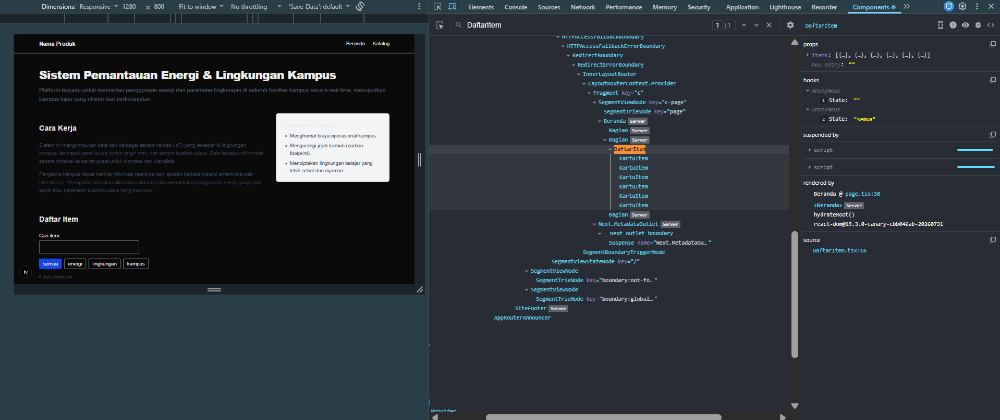
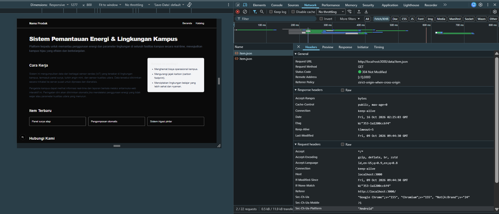
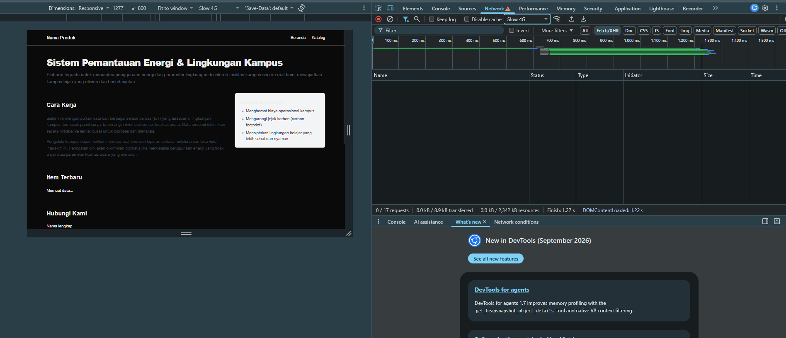
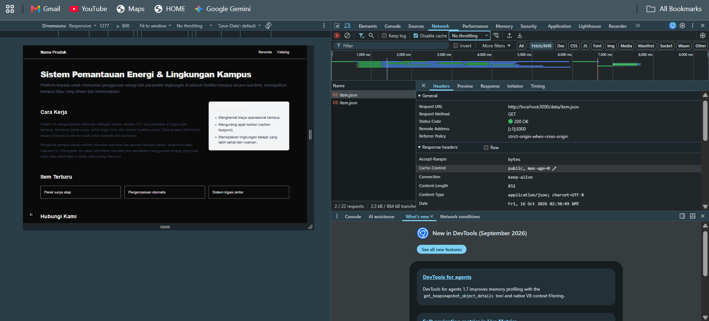
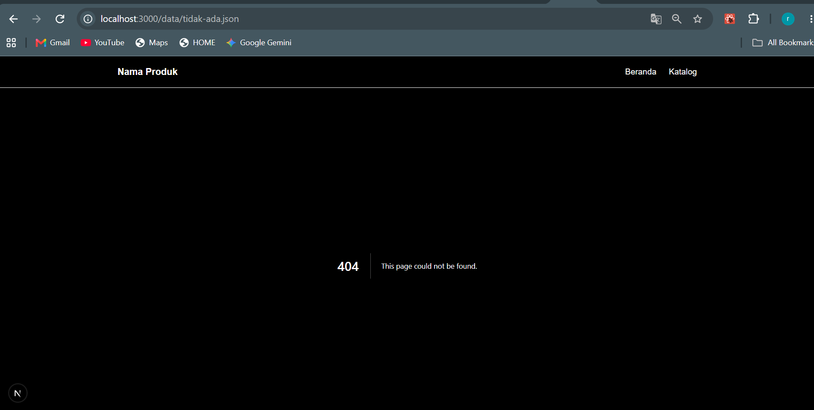

# Dokumen Praktikum Modul 3

## Tabel Komponen

| Nama Komponen | Props dan Tipe | Tempat Digunakan | Keterangan / Fungsi |
|---------------|----------------|------------------|---------------------|
| `SiteHeader` | • `namaProduk: string`<br>• `tautan: { href: string; label: string }[]` | `app/layout.tsx` | Header navigasi global aplikasi yang menampilkan nama produk dan daftar tautan navigasi. |
| `SiteFooter` | • `namaProduk: string` | `app/layout.tsx` | Footer global aplikasi yang menampilkan teks hak cipta (*copyright*) produk. |
| `Bagian` | • `id: string`<br>• `judul: string`<br>• `children: React.ReactNode` | • `app/page.tsx`<br>• `app/katalog/page.tsx` | Komponen pembungkus section semantik (`<section>`) dengan heading (`<h2>`) dan konten dinamis (`children`). |
| `DaftarItem` | • `items: Item[]` | • `app/page.tsx`<br>• `app/katalog/page.tsx` | Komponen interaktif (*client component*) untuk pencarian (input search) dan filter kategori item, lalu menampilkan daftar `KartuItem`. |
| `KartuItem` | • `item: Item` | `components/DaftarItem.tsx` | Komponen kartu (`<article>`) untuk menampilkan ringkasan data item (kategori, judul, deskripsi, dan status ketersediaan). |

## 3. State dan Interaksi

**Hasil Tangkapan Layar**


Kolom pencarian bekerja dengan cara memantau setiap ketikan pengguna melalui event onChange. Saat kita mengetik, teksnya akan disimpan menjadi nilai baru di state kataKunci. Perubahan nilai ini memicu komponen DaftarItem untuk memperbarui tampilannya. Selama proses pembaruan tersebut, aplikasi akan memfilter seluruh daftar barang, mencocokkannya dengan teks pencarian dan filter kategori yang sedang aktif, lalu menampilkan kartu produk yang lolos seleksi saja. 

## 4. Pengambilan Data 

**Hasil Tnagkapan Layar**


**Hasil Pengujian**

**Memuat Loading di DevTools**
 

**Kondisi Berhasil di DevTools**


**Kondisi Berhasil di DevTools**


## 5. Verifikasi 

**Keluaran Terminal**
```
npx tsc --noEmit
```
Tidak ada mengeluarkan output apapun, perintah selesai dan melanjutkan ke perintah berikutnya.

```
npm run lint
```
Perintah ini tidak mengeluarkan output teks apapun, berarti kode yang sudah dibuat tidak mengalami error.

## 6.  Kendala dan Penyelesaian

- Kendala: Saat menjalankan perintah npm run lint pada tahap verifikasi, muncul peringatan (warning) dari ESLint di berkas app/page.tsx dengan pesan "'DaftarItem' is defined but never used" dan "'daftarItem' is defined but never used".

- Penyelesaian: Peringatan ini muncul karena saya mengimpor komponen DaftarItem dan variabel daftarItem di halaman Beranda (app/page.tsx), padahal keduanya hanya digunakan dan dipanggil di halaman Katalog (app/katalog/page.tsx). Saya menyelesaikan masalah ini dengan menghapus kedua baris import yang tidak terpakai tersebut di app/page.tsx, menyimpan berkas, dan menjalankan ulang perintah linter hingga hasilnya berhasil tanpa mengeluarkan output apapun.

## 7. Catatan Pemanfaatan AI

Pada pengerjaan modul ini, saya memanfaatkan Google Gemini sebagai asisten untuk membantu proses *troubleshooting* dan pemahaman konsep.

| No. | Pertanyaan ke AI | Konteks Masalah | Solusi yang Diberikan AI |
|-----|-----------------|-----------------|--------------------------|
| 1 | "Ini bagaimana nih json-nya ga ada di sini?" dan "Ini isi file ItemTerbaru tetap ga bisa kenapa ya?" | Rekaman permintaan `item.json` tidak terlihat di panel Network DevTools, sehingga sulit memverifikasi apakah proses `fetch` berjalan dengan benar. | AI mengidentifikasi tiga penyebab: (1) filter panel Network salah, perlu diubah ke "Fetch/XHR", (2) komponen `<ItemTerbaru />` belum dipasang di `app/page.tsx`, dan (3) kode masih menggunakan data lokal, bukan Fetch API. AI memandu perbaikan ketiganya lalu memvalidasi di panel Network. |
| 2 | "Kenapa ada yang error ya? (terkait peringatan ESLint unused-vars)" | Saat menjalankan `npm run lint`, muncul peringatan bahwa `DaftarItem` dan `daftarItem` diimpor di `app/page.tsx` tetapi tidak pernah digunakan. | AI menjelaskan bahwa kedua import tidak diperlukan di halaman Beranda karena sudah digunakan di `app/katalog/page.tsx`. Solusinya menghapus baris import yang tidak terpakai, lalu menjalankan ulang `npm run lint` hingga tidak ada pesan galat tersisa. |
